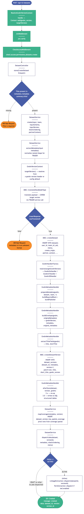

# Dataset Creation — V2 (POST /api/v2/datasets)

This diagram traces the full request/response flow for creating a new dataset via the V2 API.
The flow covers middleware resolution of the GWDM version context, JWT and permission checks, metadata normalisation, TRASER translation, dataset and version row creation, handler-based metadata preparation, spatial coverage pivot mapping, and asynchronous job dispatch for active datasets.

## Source (Mermaid)

```mermaid
flowchart TD
    A([POST /api/v2/datasets]) --> MW1

    MW1["ResolveGwdmVersionContext\n─────\nhandle → Context::add(gwdm_version, targetVersion)"]
    MW1 --> MW2

    MW2["JwtMiddleware\n─────\njwt.verify"]
    MW2 --> MW3

    MW3["CheckAccessMiddleware\n─────\ncheck.access:permissions,datasets.create"]
    MW3 --> B

    B["DatasetController\n─────\nstore(CreateDataset $request)"]
    B --> TITLE{Title present in\nmetadata.metadata\n.summary.title?}

    TITLE -- "missing" --> ERR_TITLE([400 Bad Request\nTitle is required])
    TITLE -- "present" --> C

    C["DatasetService\n─────\ncreate(input, team, inputSchema,\ninputVersion, elasticIndexing,\npartnerContext)"]
    C --> D

    D["DatasetService\n─────\nextractMetadata(input metadata)\nnormalise nested shape for TRASER"]
    D --> E

    E["GwdmVersionContext\n─────\ntargetVersion() → resolves from\nx-gwdm-version header or config default"]
    E --> F

    F["MMC::translateDataModelType\n─────\ntranslate payload → GWDM target version\nvia TRASER service call"]
    F --> TRASER{traserResponse\nwasTranslated?}

    TRASER -- "false" --> ERR_TRASER([400 Bad Request\nmetadata is in an unknown format])
    TRASER -- "true" --> G

    G["MMC::createDataset\n─────\nINSERT INTO datasets\nuser_id, team_id, pid, status,\ncreate_origin, partner_context, ..."]
    G --> H

    H["GwdmHandlerFactory\n─────\nresolve(targetGwdmVersion)\n→ Gwdm2xHandler / Gwdm21Handler / Gwdm30Handler"]
    H --> I

    I["GwdmMetadataHandler\n─────\nprepareMetadata(gwdm, dataset, team, 1)\nbuildRequiredBlock + buildPublisher"]
    I --> J

    J["GwdmMetadataHandler\n─────\nbuildEnvelope(gwdm, originalMetadata)\n→ gwdmVersion, metadata, original_metadata"]
    J --> K

    K["GwdmMetadataHandler\n─────\nextractTitleFields(gwdm)\n→ title, shortTitle"]
    K --> L

    L["MMC::createDatasetVersion\n─────\nINSERT INTO dataset_versions\ndataset_id, metadata, version=1,\npatch=null, title, short_title, gwdm_version"]
    L --> M

    M["GwdmMetadataHandler\n─────\nafterStore(dataset, version, gwdm)\n2.x → no-op\n3.0 → writes to SQL structured tables"]
    M --> N

    N["DatasetService\n─────\nmapCoverage(metadata, version)\nINSERT dataset_version_has_spatial_coverage\npivot rows from coverage.spatial"]
    N --> O

    O["DatasetService\n─────\ndispatchJobs(dataset, versionId,\nmetadata, elasticIndexing, status)"]
    O --> STATUS{status ==\nACTIVE?}

    STATUS -- "DRAFT or other\nno jobs dispatched" --> OK
    STATUS -- "ACTIVE" --> JOBS

    JOBS["(inline)\nLinkageExtraction::dispatch(datasetId, versionId)\nTermExtraction::dispatch if ted.enabled"]
    JOBS --> OK

    OK([201 Created\nmessage: created\ndata: dataset_id, version: version_id])

    classDef http     fill:#475da7,stroke:#354681,color:#fff
    classDef process  fill:#ffffff,stroke:#29235c,color:#29235c
    classDef mw       fill:#3db28c,stroke:#2a8c6e,color:#fff
    classDef decision fill:#475da7,stroke:#354681,color:#fff
    classDef ok       fill:#3db28c,stroke:#2a8c6e,color:#fff
    classDef err      fill:#f98e2b,stroke:#c96f1a,color:#111
    classDef stub     fill:#6c7cc0,stroke:#475da7,color:#fff

    class A http
    class MW1,MW2,MW3 mw
    class B,C,D,E,F,G,H,I,J,K,L,M,N,O,JOBS process
    class TITLE,TRASER,STATUS decision
    class OK ok
    class ERR_TITLE,ERR_TRASER err
```

