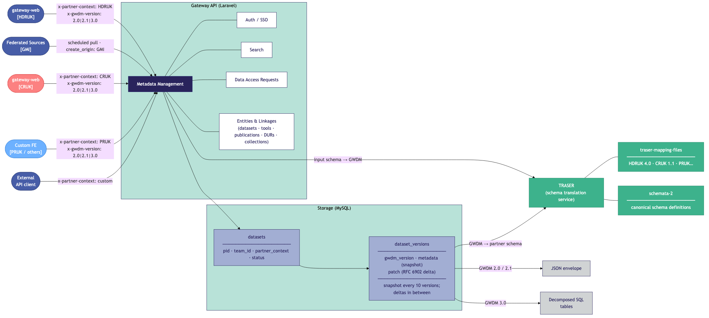
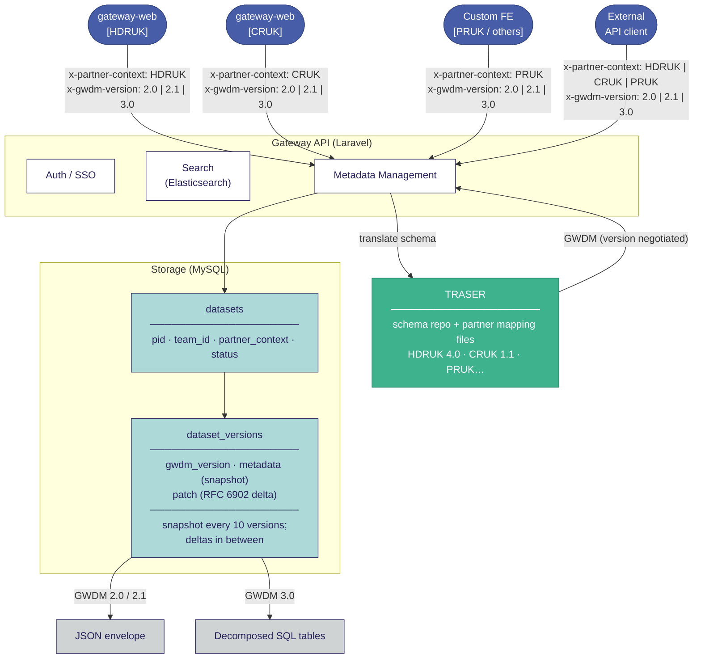

# GWDM Metadata Management — Architecture Overview

This diagram shows the top-level architecture of the Gateway 2.0 GWDM metadata management system across three tiers: partner frontends, the Laravel API (including the TRASER translation sidecar), and MySQL storage with its two persistence strategies.

Four partner frontends send metadata writes carrying `x-partner-context` and `x-gwdm-version` headers. The API's Metadata Management layer forwards the raw payload to TRASER for schema translation, receives a negotiated GWDM envelope back, and then persists it to MySQL. Versions 2.0 and 2.1 are stored as JSON envelopes (full snapshots every 10 versions with RFC 6902 delta patches in between); version 3.0 is decomposed into dedicated SQL tables.

## Source (Mermaid)

