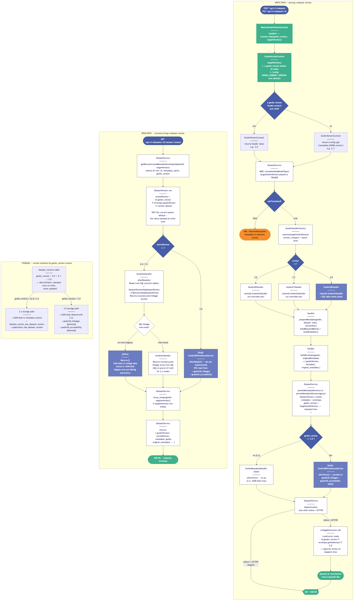

# GWDM Version Switching Architecture

The Gateway API supports writing and reading dataset metadata under multiple GWDM schema versions
(currently 2.0, 2.1, and 3.0) within a single deployment. The version to target on a given write
request is determined by the `x-gwdm-version` request header, falling back to the
`GWDM_CURRENT_VERSION` environment variable when the header is absent. The resolved version is
stamped onto the `dataset_versions.gwdm_version` column at write time and is read back verbatim
when reconstructing metadata — the system default plays no part in reads.

`GwdmHandlerFactory` is the single branching point for all version-specific behaviour. It maps a
version string to a concrete `GwdmMetadataHandler` subclass. All JSON-based versions (2.0 and 2.1)
share `Gwdm2xHandler` as their base: `afterStore()` is a no-op (metadata lives in the JSON blob)
and `afterRead()` reconstructs the `linkage` section from the `dataset_version_has_dataset_version`
and `publication_has_dataset_version` junction tables, making SQL the authoritative source of truth
for linkage data on reads. `Gwdm30Handler` overrides the same hooks to target dedicated structured
tables (`gwdm30_linkages`, `gwdm30_accessibility`) — though the implementation is currently a stub
pending schema finalisation.

The `LinkageExtraction` job captures `gwdm_version` from the `DatasetVersion` row at dispatch time
(constructor, not `handle()`), so the correct handler is selected even if the system default has
changed by the time the job runs off-queue.

## Source (Mermaid)

```mermaid
flowchart TD

    %% ── WRITE PATH ──────────────────────────────────────────────────────────

    subgraph WRITE["WRITE PATH — storing a dataset version"]
        direction TB

        HTTPIN([POST /api/v1/datasets\nPUT /api/v1/datasets/:id])

        MW["ResolveGwdmVersionContext\n─────\nhandle() → Context::add('gwdm_version', targetVersion())"]

        CTX["GwdmVersionContext\n─────\ntargetVersion()\n1. x-gwdm-version header (if valid)\n2. Config GWDM_CURRENT_VERSION (env default)"]

        HDR{x-gwdm-version\nheader present\nand valid?}

        USE_HEADER["GwdmVersionContext\n─────\nreturns header value\ne.g. '3.0'"]
        USE_DEFAULT["GwdmVersionContext\n─────\nreturns Config::get\n('metadata.GWDM.version')\ne.g. '2.1'"]

        TRASER["DatasetService\n─────\nMMC::translateDataModelType()\ntargetGwdmVersion passed to TRASER"]

        TRASER_OK{wasTranslated?}
        ERR1([400 / RuntimeException\nmetadata in unknown format])

        FACTORY["GwdmHandlerFactory\n─────\nresolve(targetGwdmVersion)\nversion_compare / match arms"]

        WHICH_HANDLER{"version\n== ?"}
        H20["Gwdm20Handler\n─────\nextends Gwdm2xHandler\n(no overrides yet)"]
        H21["Gwdm21Handler\n─────\nextends Gwdm2xHandler\n(no overrides yet)"]
        H30["Gwdm30Handler\n─────\nextends Gwdm2xHandler\n+ SQL table hooks (stub)"]

        PREPARE["handler\n─────\nprepareMetadata(gwdm, dataset, team, versionNum)\nbuildRequiredBlock() + buildPublisher()"]

        ENVELOPE["handler\n─────\nbuildEnvelope(gwdm, originalMetadata)\n→ { gwdmVersion, metadata, original_metadata }"]

        PERSIST["DatasetService\n─────\npersistMetadataVersion() or persistMetadataVersionLegacy()\nDatasetVersion::create(\n  metadata = envelope,\n  gwdm_version = targetGwdmVersion  ← stamped here\n)"]

        AFTER_STORE{"gwdm_version\n== '3.0' ?"}
        NOOP["GwdmMetadataHandler (base)\n─────\nafterStore() — no-op\n(2.x: JSON blob only)"]
        SQL30["[stub] Gwdm30PersistenceService\n─────\nafterStore() → persists to\ngwdm30_linkages +\ngwdm30_accessibility tables"]

        DISPATCH_JOBS["DatasetService\n─────\ndispatchJobs()\nonly when status = ACTIVE"]

        LINKAGE_JOB["LinkageExtraction job\n─────\nconstructor reads\ndv.gwdm_version ?? envelope.gwdmVersion ?? '2.0'\n→ captures version at dispatch time"]

        QUEUE([Queued on 'enrichment'\ntries=3 backoff=30s])

        OK_WRITE([201 / 200 OK])
    end

    %% ── READ PATH ───────────────────────────────────────────────────────────

    subgraph READ["READ PATH — reconstructing a dataset version"]
        direction TB

        HTTPOUT([GET /api/v1/datasets/:id/version/:version])

        RECON["DatasetService\n─────\ngetReconstructedMetadataEnvelope(datasetId, targetVersion)\nselects dv row: id, metadata, patch, gwdm_version"]

        STORED_VER["DatasetVersion row\n─────\nstoredVersion = dv.gwdm_version\n  ?? envelope.gwdmVersion\n  ?? context default\n\nNOT the current system default —\nthe value stamped at write time"]

        RESOLVE_READ{"storedVersion\n== ?"}

        AFTER20["Gwdm2xHandler\n─────\nafterRead(dv)\nReads from SQL junction tables:\n• DatasetVersionHasDatasetVersion\n• PublicationHasDatasetVersion\nReturns reconstructed linkage section"]

        AFTER30["[stub] Gwdm30PersistenceService\n─────\nafterRead(dv) — not yet implemented\nWill read from:\n• gwdm30_linkages\n• gwdm30_accessibility"]

        HAS_ROWS{"SQL linkage\nrows exist?"}
        FROM_JSON["(inline)\n─────\nReturns []\nFalls back to linkage data\nstored in JSON blob\n(legacy rows pre-dating extraction)"]
        FROM_SQL["Gwdm2xHandler\n─────\nReturns reconstructed\nlinkage array from SQL\n(SQL is source of truth\nfor 2.x reads)"]

        MERGE["DatasetService\n─────\narray_merge(gwdm, supplementary)\nif supplementary non-empty"]

        RESPONSE_ENV["DatasetService\n─────\nreturns:\n{ gwdmVersion: storedVersion,\n  metadata: gwdm,\n  original_metadata: ... }"]

        OK_READ([200 OK — response envelope])
    end

    %% ── STORAGE LAYER NOTE ──────────────────────────────────────────────────

    subgraph STORAGE["STORAGE — version isolation by gwdm_version column"]
        direction TB

        DV_ROW["dataset_versions table\n─────\ngwdm_version = '2.0' | '2.1' | '3.0'\n← discriminator; stamped once on write,\n   never updated"]

        STORE_2X["2.x storage path\n─────\n• JSON blob in metadata column\n• dataset_version_has_dataset_version\n• publication_has_dataset_version"]

        STORE_30["3.0 storage path\n─────\n• JSON blob (shared with 2.x)\n• gwdm30_linkages  [planned]\n• gwdm30_accessibility  [planned]"]

        DV_ROW -- "gwdm_version ∈ {2.0, 2.1}" --> STORE_2X
        DV_ROW -- "gwdm_version = 3.0" --> STORE_30
    end

    %% ── WRITE PATH CONNECTIONS ──────────────────────────────────────────────

    HTTPIN --> MW
    MW --> CTX
    CTX --> HDR
    HDR -- "yes" --> USE_HEADER
    HDR -- "no" --> USE_DEFAULT
    USE_HEADER --> TRASER
    USE_DEFAULT --> TRASER
    TRASER --> TRASER_OK
    TRASER_OK -- "false" --> ERR1
    TRASER_OK -- "true" --> FACTORY
    FACTORY --> WHICH_HANDLER
    WHICH_HANDLER -- "2.0" --> H20
    WHICH_HANDLER -- "2.1" --> H21
    WHICH_HANDLER -- "3.0" --> H30
    H20 --> PREPARE
    H21 --> PREPARE
    H30 --> PREPARE
    PREPARE --> ENVELOPE
    ENVELOPE --> PERSIST
    PERSIST --> AFTER_STORE
    AFTER_STORE -- "no (2.x)" --> NOOP
    AFTER_STORE -- "yes" --> SQL30
    NOOP --> DISPATCH_JOBS
    SQL30 --> DISPATCH_JOBS
    DISPATCH_JOBS -- "status = ACTIVE" --> LINKAGE_JOB
    DISPATCH_JOBS -- "status != ACTIVE\nskipped" --> OK_WRITE
    LINKAGE_JOB --> QUEUE
    QUEUE --> OK_WRITE

    %% ── READ PATH CONNECTIONS ───────────────────────────────────────────────

    HTTPOUT --> RECON
    RECON --> STORED_VER
    STORED_VER --> RESOLVE_READ
    RESOLVE_READ -- "2.0 / 2.1" --> AFTER20
    RESOLVE_READ -- "3.0" --> AFTER30
    AFTER20 --> HAS_ROWS
    HAS_ROWS -- "no rows (legacy)" --> FROM_JSON
    HAS_ROWS -- "rows found" --> FROM_SQL
    FROM_JSON --> MERGE
    FROM_SQL --> MERGE
    AFTER30 --> MERGE
    MERGE --> RESPONSE_ENV
    RESPONSE_ENV --> OK_READ

    %% ── CLASS ASSIGNMENTS ───────────────────────────────────────────────────

    classDef http     fill:#475da7,stroke:#354681,color:#fff
    classDef process  fill:#ffffff,stroke:#29235c,color:#29235c
    classDef mw       fill:#3db28c,stroke:#2a8c6e,color:#fff
    classDef decision fill:#475da7,stroke:#354681,color:#fff
    classDef ok       fill:#3db28c,stroke:#2a8c6e,color:#fff
    classDef err      fill:#f98e2b,stroke:#c96f1a,color:#111
    classDef stub     fill:#6c7cc0,stroke:#475da7,color:#fff

    class HTTPIN,HTTPOUT http
    class MW,CTX mw
    class H20,H21,PREPARE,ENVELOPE,PERSIST,DISPATCH_JOBS,LINKAGE_JOB,TRASER,RECON,STORED_VER,AFTER20,HAS_ROWS,FROM_SQL,MERGE,RESPONSE_ENV,FACTORY,NOOP process
    class HDR,TRASER_OK,AFTER_STORE,WHICH_HANDLER,RESOLVE_READ decision
    class OK_WRITE,OK_READ,QUEUE ok
    class ERR1 err
    class H30,SQL30,AFTER30,FROM_JSON stub
```

## Rollback guarantee

Because the read path resolves the handler from the `gwdm_version` column on the stored row — not
from the live system default — rolling the deployment back to a GWDM 2.x system default has no
effect on rows that were written under that version. A row stamped `gwdm_version = '2.1'` will
always be read by `Gwdm21Handler` (which inherits `Gwdm2xHandler`'s junction-table reconstruction),
and a row stamped `gwdm_version = '3.0'` will always be read by `Gwdm30Handler`. There is no
mechanism by which a system-default change can cause a 2.x row to be read through a 3.0 handler
or vice versa.

The same isolation applies to `LinkageExtraction`: the job captures `gwdm_version` at constructor
time from the persisted row, so even if the job executes days later after a config change, it calls
`GwdmHandlerFactory::resolve()` with the version the row was written under.
