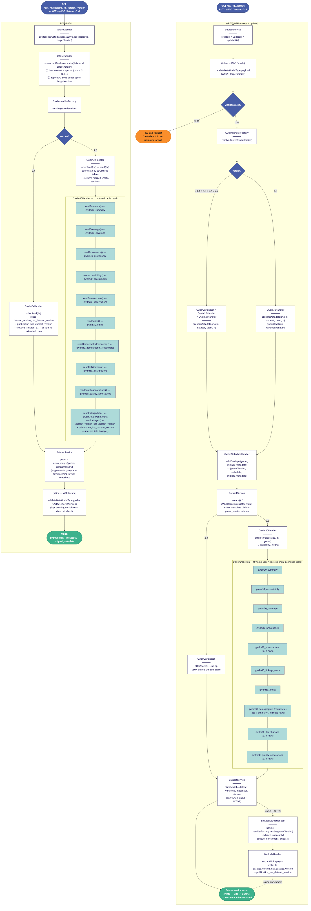

# GWDM 3.0 Dataset Version — Persistence and Read Lifecycle

This diagram covers the full lifecycle of a GWDM 3.0 dataset version in the Gateway API 2 Laravel application: from an inbound POST/PUT request through TRASER translation, handler resolution, structured-table persistence, and asynchronous linkage extraction on the write path; and from a GET request through RFC 6902 snapshot/delta reconstruction, handler-driven SQL table reads, and final GWDM validation on the read path.

The key distinction from GWDM 2.x is that `Gwdm30Handler::afterStore()` writes every GWDM section to ten dedicated SQL tables inside a single `DB::transaction`, while `Gwdm2xHandler::afterStore()` is a no-op that leaves the JSON blob as the sole store. On read, `Gwdm30Handler::afterRead()` reconstructs the full GWDM object from those tables and merges it over the snapshot; `Gwdm2xHandler::afterRead()` reads only the linkage junction tables.

## Source (Mermaid)

```mermaid
flowchart TD
    %% ── Entry points ─────────────────────────────────────────────────────────────
    POST([POST /api/v1/datasets\nPUT /api/v3/datasets/:id])

    %% ── Write path ───────────────────────────────────────────────────────────────
    subgraph WRITE["WRITE PATH  (create / update)"]
        direction TB
        DS_W["DatasetService\n─────\ncreate() / update() / updateV2()"]
        MMC["(inline — MMC facade)\n─────\ntranslateDataModelType(payload, 'GWDM', targetVersion)"]
        TRANS{wasTranslated?}
        FACTORY_W["GwdmHandlerFactory\n─────\nresolve(targetGwdmVersion)"]
        HANDLER_SEL{version?}
        H2X["Gwdm2xHandler / Gwdm20Handler\n/ Gwdm21Handler\n─────\nprepareMetadata(gwdm, dataset, team, n)"]
        H30_PREP["Gwdm30Handler\n─────\nprepareMetadata(gwdm, dataset, team, n)\n(inherited from Gwdm2xHandler)"]
        BUILD_ENV["GwdmMetadataHandler\n─────\nbuildEnvelope(gwdm, original_metadata)\n→ {gwdmVersion, metadata, original_metadata}"]
        DV_SAVE["DatasetVersion\n─────\n::create() / MMC::createDatasetVersion()\nwrites metadata JSON + gwdm_version column"]
        AFTER_NOP["Gwdm2xHandler\n─────\nafterStore() → no-op\nJSON blob is the sole store"]
        AFTER_30["Gwdm30Handler\n─────\nafterStore(dataset, dv, gwdm)\n→ persist(dv, gwdm)"]

        subgraph TX["DB::transaction — 10-table upsert (delete-then-insert per table)"]
            direction TB
            T1["gwdm30_summary"]
            T2["gwdm30_accessibility"]
            T3["gwdm30_coverage"]
            T4["gwdm30_provenance"]
            T5["gwdm30_observations (0..n rows)"]
            T6["gwdm30_linkage_meta"]
            T7["gwdm30_omics"]
            T8["gwdm30_demographic_frequencies\n(age / ethnicity / disease rows)"]
            T9["gwdm30_distributions (0..n rows)"]
            T10["gwdm30_quality_annotations (0..n rows)"]
        end

        DISPATCH["DatasetService\n─────\ndispatchJobs(dataset, versionId, metadata, status)\n(only when status = ACTIVE)"]
        LINK_JOB["LinkageExtraction job\n─────\nhandle() → handlerFactory.resolve(gwdmVersion)\n.extractLinkages(dv)\n[queue: enrichment, tries: 3]"]
        EXTRACT_LNK["Gwdm2xHandler\n─────\nextractLinkages(dv)\nwrites to dataset_version_has_dataset_version\n+ publication_has_dataset_version"]

        WRITE_OK([DatasetVersion saved\ncreate → 201  /  update → version number returned])
    end

    %% ── Read path ────────────────────────────────────────────────────────────────
    GET([GET /api/v1/datasets/:id/version/:version\nor GET /api/v3/datasets/:id])

    subgraph READ["READ PATH"]
        direction TB
        DS_R["DatasetService\n─────\ngetReconstructedMetadataEnvelope(datasetId, targetVersion)"]
        RECON["DatasetService\n─────\nreconstructGwdmMetadata(datasetId, targetVersion)\n① load nearest snapshot (patch IS NULL)\n② apply RFC 6902 deltas up to targetVersion"]
        FACTORY_R["GwdmHandlerFactory\n─────\nresolve(storedVersion)"]
        HANDLER_R{version?}
        AR_NOP["Gwdm2xHandler\n─────\nafterRead(dv)\nreads dataset_version_has_dataset_version\n+ publication_has_dataset_version\n→ returns {linkage: {...}} or {} if no extracted rows"]
        AR_30["Gwdm30Handler\n─────\nafterRead(dv) → read(dv)\nqueries all 10 structured tables\n→ returns merged GWDM sections"]

        subgraph READ30["Gwdm30Handler — structured table reads"]
            direction TB
            R1["readSummary() ← gwdm30_summary"]
            R2["readCoverage() ← gwdm30_coverage"]
            R3["readProvenance() ← gwdm30_provenance"]
            R4["readAccessibility() ← gwdm30_accessibility"]
            R5["readObservations() ← gwdm30_observations"]
            R6["readOmics() ← gwdm30_omics"]
            R7["readDemographicFrequency() ← gwdm30_demographic_frequencies"]
            R8["readDistributions() ← gwdm30_distributions"]
            R9["readQualityAnnotations() ← gwdm30_quality_annotations"]
            R10["readLinkageMeta() ← gwdm30_linkage_meta\nreadLinkages() ← dataset_version_has_dataset_version\n+ publication_has_dataset_version\n→ merged into linkage{}"]
        end

        MERGE["DatasetService\n─────\ngwdm = array_merge(gwdm, supplementary)\n(supplementary replaces any matching keys in snapshot)"]
        VALIDATE["(inline — MMC facade)\n─────\nvalidateDataModelType(gwdm, 'GWDM', storedVersion)\n(logs warning on failure — does not abort)"]
        READ_OK([200 OK\ngwdmVersion + metadata + original_metadata])
    end

    %% ── Error terminals ──────────────────────────────────────────────────────────
    ERR_TRANS([400 Bad Request\n'metadata is in an unknown format'])

    %% ── Edges — Write path ───────────────────────────────────────────────────────
    POST --> DS_W
    DS_W --> MMC
    MMC --> TRANS
    TRANS -- "false" --> ERR_TRANS
    TRANS -- "true" --> FACTORY_W
    FACTORY_W --> HANDLER_SEL
    HANDLER_SEL -- "< 1.1 / 2.0 / 2.1 / 2.x" --> H2X
    HANDLER_SEL -- "3.0" --> H30_PREP
    H2X --> BUILD_ENV
    H30_PREP --> BUILD_ENV
    BUILD_ENV --> DV_SAVE
    DV_SAVE -- "2.x" --> AFTER_NOP
    DV_SAVE -- "3.0" --> AFTER_30
    AFTER_30 --> TX
    T1 --- T2 --- T3 --- T4 --- T5 --- T6 --- T7 --- T8 --- T9 --- T10
    AFTER_NOP --> DISPATCH
    TX --> DISPATCH
    DISPATCH -- "status = ACTIVE" --> LINK_JOB
    LINK_JOB --> EXTRACT_LNK
    DISPATCH --> WRITE_OK
    EXTRACT_LNK -.->|async enrichment| WRITE_OK

    %% ── Edges — Read path ────────────────────────────────────────────────────────
    GET --> DS_R
    DS_R --> RECON
    RECON --> FACTORY_R
    FACTORY_R --> HANDLER_R
    HANDLER_R -- "2.x" --> AR_NOP
    HANDLER_R -- "3.0" --> AR_30
    AR_30 --> READ30
    R1 --- R2 --- R3 --- R4 --- R5 --- R6 --- R7 --- R8 --- R9 --- R10
    AR_NOP --> MERGE
    READ30 --> MERGE
    MERGE --> VALIDATE
    VALIDATE --> READ_OK

    %% ── Class definitions ────────────────────────────────────────────────────────
    classDef http     fill:#475da7,stroke:#354681,color:#fff
    classDef process  fill:#ffffff,stroke:#29235c,color:#29235c
    classDef mw       fill:#3db28c,stroke:#2a8c6e,color:#fff
    classDef decision fill:#475da7,stroke:#354681,color:#fff
    classDef ok       fill:#3db28c,stroke:#2a8c6e,color:#fff
    classDef err      fill:#f98e2b,stroke:#c96f1a,color:#111
    classDef stub     fill:#6c7cc0,stroke:#475da7,color:#fff
    classDef table    fill:#addad9,stroke:#29235c,color:#29235c

    class POST,GET http
    class DS_W,MMC,FACTORY_W,H2X,H30_PREP,BUILD_ENV,DV_SAVE,AFTER_NOP,AFTER_30,DISPATCH,LINK_JOB,EXTRACT_LNK process
    class DS_R,RECON,FACTORY_R,AR_NOP,AR_30,MERGE,VALIDATE process
    class TRANS,HANDLER_SEL,HANDLER_R decision
    class WRITE_OK,READ_OK ok
    class ERR_TRANS err
    class T1,T2,T3,T4,T5,T6,T7,T8,T9,T10 table
    class R1,R2,R3,R4,R5,R6,R7,R8,R9,R10 table
```

