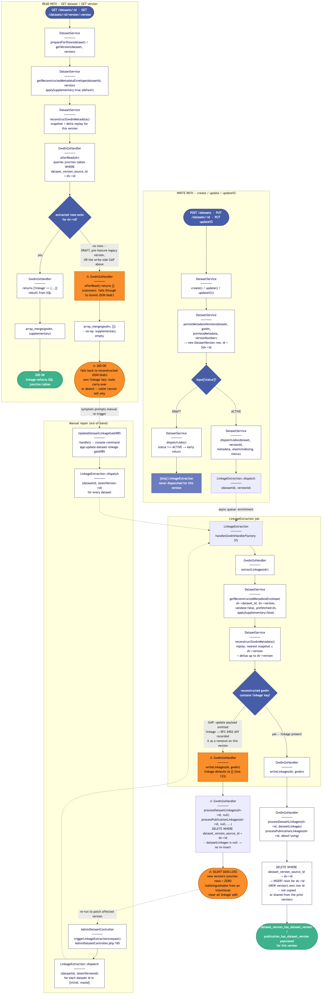

# Dataset-Version Linkage Extraction Pipeline (and the silent-loss gap)

Covers the end-to-end lifecycle of dataset/publication linkage junction rows in Gateway 2.0: the write-side dispatch of the `LinkageExtraction` job from `DatasetService::create()` / `update()` / `updateV2()` (gated on `status === ACTIVE`), the job's replay of that specific version's reconstructed GWDM metadata (`Gwdm2xHandler::extractLinkages()` → `getReconstructedMetadataEnvelope()` → `writeLinkages()` → delete-then-insert into `dataset_version_has_dataset_version` / `publication_has_dataset_version`, scoped to the **new** version's own `dataset_version_source_id`), and the read-side reconstruction (`afterRead()`) that queries those same junction tables.

The diagram highlights (orange, dashed border, ⚠) the gap the team identified: if an update payload omits the `linkage` section, the RFC 6902 diff records it as a *removal*, so the reconstructed GWDM for the new version has no `linkage` key. `writeLinkages()` still runs its delete-then-insert — it deletes the (already-empty, since this is a new row) rows for the new version's id and inserts nothing, because `datasetLinkages`/`publicationLinkages` are `null`. The new version silently ends up with zero linkage rows, with no way to distinguish "extraction never ran" from "the user intentionally cleared all linkage." On read, `afterRead()` finds no extracted rows and returns `[]`, which no-ops through `array_merge()`, so the caller falls back to whatever `linkage` key (stale or absent) survived in the reconstructed JSON blob. The only current fix is out-of-band: `AdminDatasetController::triggerLinkageExtraction()` (`app/Http/Controllers/Api/V1/AdminDatasetController.php:185`) and the `UpdateDatasetLinkageGat6985` console command both re-dispatch `LinkageExtraction` against latest versions after the fact.

## Source (Mermaid)

```mermaid
flowchart TD

    %% ── WRITE PATH ──────────────────────────────────────────────────────────
    subgraph WRITE["WRITE PATH — create / update / updateV2"]
    direction TB
        A(["POST /datasets  ·  PUT /datasets/:id  ·  PUT updateV2"]) --> B["DatasetService\n─────\ncreate() / update() / updateV2()"]
        B --> C["DatasetService\n─────\npersistMetadataVersion(dataset, gwdm,\npreviousMetadata, versionNumber)\n→ new DatasetVersion row, id = $dv->id"]
        C --> D{"input['status']?"}
        D -- "DRAFT" --> D1["DatasetService\n─────\ndispatchJobs()\nstatus !== ACTIVE → early return"]
        D1 --> SKIP["[skip] LinkageExtraction\nnever dispatched for this version"]
        D -- "ACTIVE" --> E["DatasetService\n─────\ndispatchJobs(dataset, versionId,\nmetadata, elasticIndexing, status)"]
        E --> F["LinkageExtraction::dispatch\n─────\n(datasetId, versionId)"]
    end

    F -.async queue: enrichment.-> G

    %% ── JOB ──────────────────────────────────────────────────────────────────
    subgraph JOB["LinkageExtraction job"]
    direction TB
        G["LinkageExtraction\n─────\nhandle(GwdmHandlerFactory $f)"]
        G --> H["Gwdm2xHandler\n─────\nextractLinkages(dv)"]
        H --> I["DatasetService\n─────\ngetReconstructedMetadataEnvelope(\n  dv->dataset_id, dv->version,\n  validate:false, prefetched:dv,\n  applySupplementary:false)"]
        I --> I1["DatasetService\n─────\nreconstructGwdmMetadata()\nreplay: nearest snapshot ≤ dv->version\n+ deltas up to dv->version"]
        I1 --> J{"reconstructed gwdm\ncontains 'linkage' key?"}
        J -- "yes — linkage present" --> K["Gwdm2xHandler\n─────\nwriteLinkages(dv, gwdm)"]
        J -- "GAP: update payload omitted\nlinkage → RFC 6902 diff recorded\nit as a removal on this version" --> GAP["⚠ Gwdm2xHandler\n─────\nwriteLinkages(dv, gwdm)\nlinkage defaults to [] (line 133)"]
    end

    K --> L["Gwdm2xHandler\n─────\nprocessDatasetLinkages(dv->id, datasetLinkages)\nprocessPublicationLinkages(dv->id, about/using)"]
    L --> N["DELETE WHERE dataset_version_source_id = dv->id\n→ INSERT rows for dv->id\n(NEW version's own row id — not copied\nor shared from the prior version)"]
    N --> OK1(["dataset_version_has_dataset_version /\npublication_has_dataset_version populated\nfor this version"])

    GAP --> M["⚠ Gwdm2xHandler\n─────\nprocessDatasetLinkages(dv->id, null)\nprocessPublicationLinkages(dv->id, null, ...)\nDELETE WHERE dataset_version_source_id = dv->id\n— datasetLinkages is null → no re-insert"]
    M --> GAPRESULT(["⚠ SILENT DATA LOSS\nnew version's junction rows = ZERO\nindistinguishable from an intentional\n'clear all linkage' edit"])

    %% ── READ PATH ────────────────────────────────────────────────────────────
    subgraph READ["READ PATH — GET dataset / GET version"]
    direction TB
        P(["GET /datasets/:id  ·  GET /datasets/:id/version/:version"]) --> Q["DatasetService\n─────\nprepareForShow(dataset) / getVersion(dataset, version)"]
        Q --> R["DatasetService\n─────\ngetReconstructedMetadataEnvelope(datasetId, version)\napplySupplementary:true (default)"]
        R --> S["DatasetService\n─────\nreconstructGwdmMetadata()\nsnapshot + delta replay for this version"]
        S --> T["Gwdm2xHandler\n─────\nafterRead(dv)\nqueries junction tables WHERE\ndataset_version_source_id = dv->id"]
        T --> U{"extracted rows exist\nfor dv->id?"}
        U -- "yes" --> V["Gwdm2xHandler\n─────\nreturns ['linkage' => {...}]\nrebuilt from SQL"]
        V --> W["array_merge(gwdm, supplementary)"]
        W --> OK2(["200 OK\nlinkage reflects SQL junction tables"])
        U -- "no rows —\nDRAFT, pre-feature legacy version,\nOR the write-side GAP above" --> X["⚠ Gwdm2xHandler\n─────\nafterRead() returns []\n(comment: 'falls through to stored JSON blob')"]
        X --> Y["array_merge(gwdm, [])\n— no-op, supplementary empty"]
        Y --> Z(["⚠ 200 OK\nfalls back to reconstructed JSON blob's\nown 'linkage' key: stale carry-over\nor absent — caller cannot tell why"])
    end

    %% ── OUT-OF-BAND REPAIR ───────────────────────────────────────────────────
    subgraph REPAIR["Manual repair (out-of-band)"]
    direction TB
        AA["AdminDatasetController\n─────\ntriggerLinkageExtraction(request)\nAdminDatasetController.php:185"]
        AB["UpdateDatasetLinkageGat6985\n─────\nhandle() — console command\napp:update-dataset-linkage-gat6985"]
        AA --> AC["LinkageExtraction::dispatch\n─────\n(datasetId, latestVersionId)\nfor each dataset id in [minId, maxId]"]
        AB --> AD["LinkageExtraction::dispatch\n─────\n(datasetId, latestVersion->id)\nfor every dataset"]
    end

    GAPRESULT -.re-run to patch affected version.-> AA
    Z -.symptom prompts manual re-trigger.-> AB
    AC -.-> G
    AD -.-> G

    %% ── STYLES ───────────────────────────────────────────────────────────────
    classDef http     fill:#475da7,stroke:#354681,color:#fff
    classDef process  fill:#ffffff,stroke:#29235c,color:#29235c
    classDef mw       fill:#3db28c,stroke:#2a8c6e,color:#fff
    classDef decision fill:#475da7,stroke:#354681,color:#fff
    classDef ok       fill:#3db28c,stroke:#2a8c6e,color:#fff
    classDef err      fill:#f98e2b,stroke:#c96f1a,color:#111
    classDef stub     fill:#6c7cc0,stroke:#475da7,color:#fff
    classDef gap      fill:#f98e2b,stroke:#c96f1a,color:#111,stroke-width:3px,stroke-dasharray: 4 2

    class A,P http
    class B,C,D1,E,H,I,I1,K,L,N,Q,R,S,T,V,W,Y,AA,AB,AC,AD process
    class D,J,U decision
    class OK1,OK2 ok
    class SKIP stub
    class GAP,GAPRESULT,X,Z gap
```

