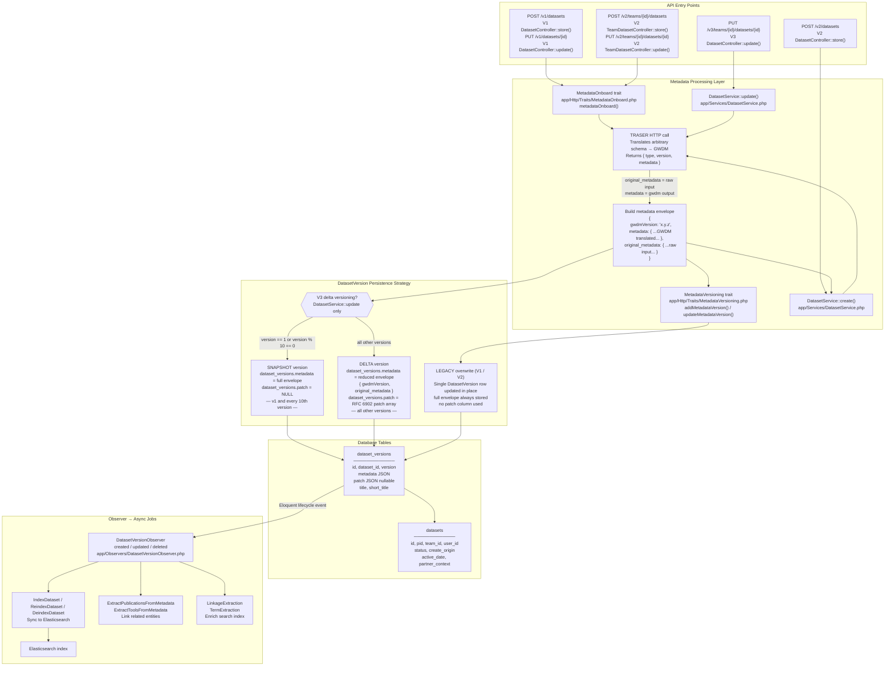

# Dataset Metadata Flow

How metadata is ingested, translated, versioned, and persisted to `datasets` + `dataset_versions`.



## Key source files

| File | Role |
|---|---|
| `app/Services/DatasetService.php` | V3 delta versioning via `persistMetadataVersion()`; assigns `original_metadata` before TRASER call |
| `app/Http/Traits/MetadataOnboard.php` | V1/V2 create path — calls TRASER, builds envelope, creates `DatasetVersion` |
| `app/Http/Traits/MetadataVersioning.php` | V1/V2 update path — `addMetadataVersion()` / `updateMetadataVersion()` overwrites version row |
| `app/Models/DatasetVersion.php` | Custom `metadata` Attribute accessor handles double-JSON-encoding edge case |
| `app/Observers/DatasetVersionObserver.php` | Triggers Elastic indexing + extraction jobs on every version save |
| `database/migrations/2026_03_11_133600_add_patch_to_dataset_versions_table.php` | Introduces `patch` column and makes `metadata` nullable for delta versioning |

## Envelope shape

All three API versions store metadata in `dataset_versions.metadata` as a JSON envelope with this top-level structure:

```json
{
  "gwdmVersion": "2.0.0",
  "metadata": { },
  "original_metadata": { }
}
```

- **`gwdmVersion`** — the GWDM schema version the translated `metadata` conforms to
- **`metadata`** — GWDM-translated output from TRASER; omitted in delta versions (reconstructed by applying the `patch`)
- **`original_metadata`** — the raw input as submitted by the caller before TRASER translation; always present

See `docs/metadata-snapshot-example.json` and `docs/metadata-delta-example.json` for concrete examples.

## Delta reconstruction

To read the full metadata for any version:

1. Find the nearest snapshot at or below the target version (where `patch IS NULL`)
2. Apply each subsequent delta's `patch` (RFC 6902) in version order to the snapshot's `metadata`
3. This is handled by `DatasetService::getReconstructedMetadataEnvelope()` and `DatasetService::prepareForShow()`
