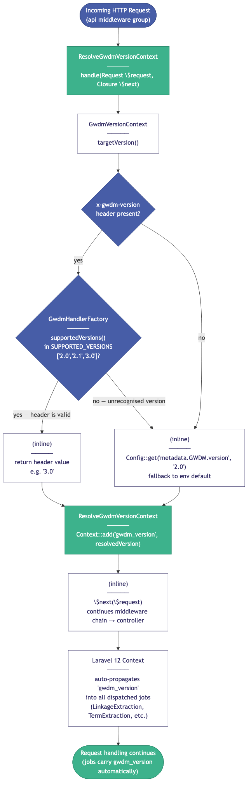
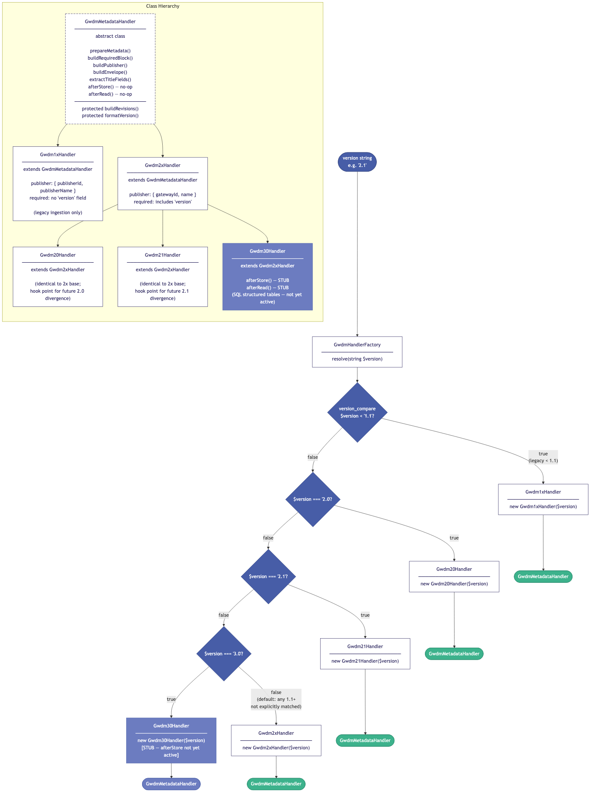
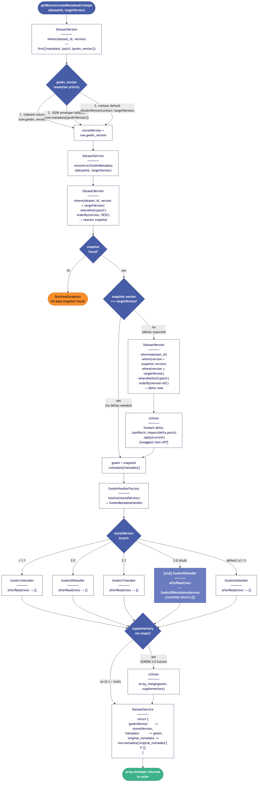
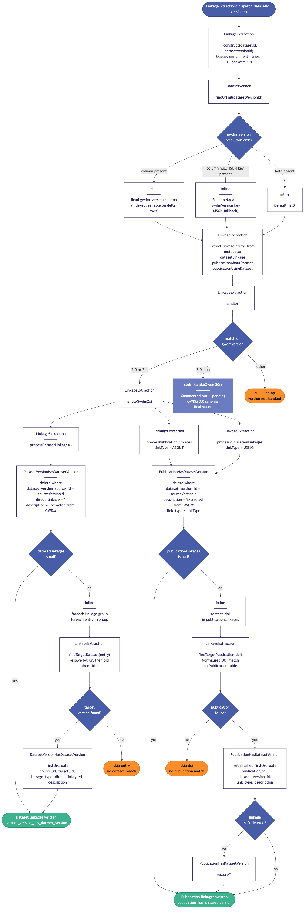

# Metadata Management System — Technical Review

**Branch:** `dev`
**Reviewed:** 2026-06-18
**Scope:** GWDM version-aware write/read path, handler hierarchy, context objects,
middleware, GWDM 3.0 stub infrastructure, and related migrations.

---

## Executive Summary

This change-set introduces a **GWDM schema version–aware metadata lifecycle** into
the Gateway API. Previously, DatasetService contained scattered `version_compare()`
calls and hardcoded field-format logic. The refactor replaces all of that with a
clean Strategy pattern: a `GwdmHandlerFactory` resolves the correct handler for a
given GWDM version, and each handler encapsulates exactly what differs between
versions (publisher field shape, required-block fields, structured-SQL persistence
hooks for 3.0).

Two supporting context objects (`GwdmVersionContext`, `OutputSchemaContext`) provide
a consistent, header-driven resolution mechanism for both write-path version targeting
and read-path schema translation. A new middleware (`ResolveGwdmVersionContext`)
writes the resolved GWDM version into Laravel's request-scoped `Context` facade,
which Laravel 12 automatically propagates into dispatched jobs—meaning
`LinkageExtraction`, `TermExtraction`, and future enrichment jobs receive the correct
version without constructor-level passing.

A `gwdm_version` column is added to `dataset_versions`, providing an indexed,
queryable discriminator that replaces JSON-path extraction from the metadata
envelope. The GWDM 3.0 structured-SQL tables are scaffolded (models, stubs, commented
migration) but deliberately not activated—the schema is not yet finalised.

The net effect on existing callers is zero: when no `x-gwdm-version` header is
present, the system defaults to `Config::get('metadata.GWDM.version')`, which
preserves prior behaviour exactly.

---

## 1. Context Objects

### Files
- `app/Context/GwdmVersionContext.php`
- `app/Context/OutputSchemaContext.php`

### What they do

`GwdmVersionContext` resolves the GWDM version to **write** metadata under.
Resolution order (highest to lowest priority):

1. `x-gwdm-version` HTTP request header — validated against `GwdmHandlerFactory::SUPPORTED_VERSIONS`
2. `Config::get('metadata.GWDM.version')` — system default from `GWDM_CURRENT_VERSION` env var

`OutputSchemaContext` resolves the schema model and version to **translate output to** on read.
Resolution order:

1. `?schema_model` / `?schema_version` query params (handled by the controller, not this class)
2. `x-schema-model` / `x-schema-version` HTTP headers — surfaced by this class
3. `null` — no translation; return stored GWDM

### Design observations

Both classes are thin value objects with no state beyond reading the current request.
They are resolved via the container using constructor injection, which is correct: they
are never instantiated with `new` in application code. The `GwdmVersionContext` deliberately
delegates the supported-version list to `GwdmHandlerFactory::SUPPORTED_VERSIONS`, making the
factory the single source of truth. That relationship is one-way and correct.

`OutputSchemaContext` carries a comment explicitly stating it is not needed in queued jobs
(output translation is a synchronous read concern). This is an important boundary to preserve.

### Flow — GWDM Version Resolution



---

## 2. Middleware

### File
- `app/Http/Middleware/ResolveGwdmVersionContext.php`

### Registration

Added to the `api` middleware group in `app/Http/Kernel.php`:

```php
'api' => [
    'throttle:api',
    \Illuminate\Routing\Middleware\SubstituteBindings::class,
    \App\Http\Middleware\ResolveGwdmVersionContext::class,
],
```

### What it does

Calls `GwdmVersionContext::targetVersion()` and writes the result into Laravel's
`Context` facade under the key `gwdm_version`. Because it is placed in the `api`
group (not global middleware), it only runs for `api/*` routes—correct, since only
those routes do metadata writes.

### Key property — job propagation

Laravel 12 automatically copies `Context` entries into any jobs dispatched during
the same request lifecycle. This means `LinkageExtraction`, `TermExtraction`, and
any future enrichment jobs dispatched from within a request automatically receive
the `gwdm_version` value. The middleware comment documents this correctly.

### Design observations

- The middleware is a **no-op** when no `x-gwdm-version` header is present: it writes
  the config default into `Context`, which matches what everything was doing before.
  Backward compatibility is preserved.
- The middleware depends on `GwdmVersionContext` via constructor injection and is
  therefore testable in isolation.
- `OutputSchemaContext` is intentionally **not** wired through middleware—it is read
  directly in controllers at the point of use. This is consistent with the design
  intent: output schema selection is a per-endpoint read concern, not a pipeline concern.

---

## 3. GWDM Handler Hierarchy

### Files
- `app/Services/Gwdm/GwdmMetadataHandler.php` (abstract base)
- `app/Services/Gwdm/GwdmHandlerFactory.php`
- `app/Services/Gwdm/Gwdm1xHandler.php`
- `app/Services/Gwdm/Gwdm2xHandler.php`
- `app/Services/Gwdm/Gwdm20Handler.php`
- `app/Services/Gwdm/Gwdm21Handler.php`
- `app/Services/Gwdm/Gwdm30Handler.php`

### Class hierarchy and handler factory resolution



### What each handler provides

| Handler | Publisher field shape | `required.version` field | `afterStore` / `afterRead` |
|---|---|---|---|
| `Gwdm1xHandler` | `{publisherId, publisherName}` | Absent | no-op |
| `Gwdm2xHandler` | `{gatewayId, name}` | Present (`"X.0.0"`) | no-op |
| `Gwdm20Handler` | Inherits 2.x | Inherits 2.x | no-op (override slot) |
| `Gwdm21Handler` | Inherits 2.x | Inherits 2.x | no-op (override slot) |
| `Gwdm30Handler` | Inherits 2.x | Inherits 2.x | Stubs for SQL persistence |

### `afterStore` and `afterRead` hooks

`GwdmMetadataHandler` defines two persistence lifecycle hooks that are no-ops
for all JSON-based versions:

- `afterStore(Dataset, DatasetVersion, array $gwdm): void` — called after the
  `dataset_versions` row is written. `Gwdm30Handler` will use this to persist
  structured fields to dedicated SQL tables.
- `afterRead(DatasetVersion): array` — called during version reconstruction.
  Returns supplementary data to merge into the GWDM envelope. `Gwdm30Handler`
  will read from SQL tables here when activated.

Both are currently stubs in `Gwdm30Handler` (bodies commented out), but the
calling code in `DatasetService` already invokes them unconditionally, so
activating the 3.0 persistence service requires only uncommenting those bodies.

---

## 4. DatasetService Changes

### File
- `app/Services/DatasetService.php`

### Summary of changes

1. `GwdmVersionContext` and `GwdmHandlerFactory` are now constructor-injected
   dependencies, replacing the scattered `Config::get` and `version_compare` calls.
2. All three write methods (`create`, `update`, `updateV2`) now call
   `$this->handlerFactory->resolve($targetGwdmVersion)` to get a handler and
   delegate the per-version mutations to it.
3. `gwdm_version` is now written to every `DatasetVersion` row at creation/update
   time (replaces `gwdmVersion` in the JSON envelope as the authoritative store).
4. `handler->afterStore()` is called after every version write, providing the
   hook for GWDM 3.0 structured-SQL persistence.
5. `getReconstructedMetadataEnvelope()` now reads `gwdm_version` from the indexed
   column first, falling back to the JSON envelope, then to the context default.
6. `handler->afterRead()` is called during reconstruction, allowing 3.0 supplementary
   data to be merged in.
7. `getLinkages()` contains a commented-out GWDM 3.0 extension point that will
   query `DatasetVersionLinkage` instead of the junction table when 3.0 rows are present.

### Dataset creation flow (V2 `store`)


### Version reconstruction (read path)



---

## 5. DatasetVersion Model

### File
- `app/Models/DatasetVersion.php`

### Changes

`gwdm_version` is added to `$fillable`:

```php
protected $fillable = [
    'dataset_id',
    'metadata',
    'patch',
    'version',
    'title',
    'short_title',
    'gwdm_version',   // new
];
```

No cast is needed — `gwdm_version` is a plain `VARCHAR(20)` string column.
The comment explains why this column exists: it is an indexed discriminator
that replaces reading `metadata->gwdmVersion`, which is absent on delta rows
and unindexed on all rows.

No other structural changes to the model are made in this diff. The existing
`linkedDatasetVersions`, `reducedLinkedDatasetVersions`, and other relations
are untouched.

---

## 6. LinkageExtraction Job

### File
- `app/Jobs/LinkageExtraction.php`

### Changes

1. A `$gwdmVersion` property is populated in the constructor by reading
   `$version->gwdm_version` first, falling back to `$version->metadata['gwdmVersion']`,
   then to `'2.0'`. This uses the new indexed column where it exists, avoids
   JSON extraction on delta rows.

2. The `handle()` method now dispatches via a `match` expression:

```php
match (true) {
    in_array($this->gwdmVersion, ['2.0', '2.1'], true) => $this->handleGwdm2x(),
    // '3.0' => $this->handleGwdm30(),
    default => null,
};
```

The `handleGwdm30()` stub is commented out with a note that it will write to
`dataset_version_gwdm30_linkages` instead of the junction table.

### Flow — Linkage extraction (2.x)



---

## 7. FormHydrationController

### File
- `app/Http/Controllers/Api/V1/FormHydrationController.php`

### Changes

1. Both `GwdmVersionContext` and `OutputSchemaContext` are now constructor-injected.
2. A `DEFAULTS_PATHS` constant maps GWDM version strings to the dot-path locations
   of accessibility fields within the metadata envelope. Version `2.1` is an empty
   array that inherits from `2.0`; `3.0` is not yet listed (a comment notes it
   should be added when structured SQL columns replace JSON paths).
3. `getDefaultValues()` now resolves `$gwdmVersion` from `$this->gwdmVersionContext`
   and uses `DEFAULTS_PATHS[$gwdmVersion] ?? DEFAULTS_PATHS['2.0']` to select paths,
   replacing hardcoded path strings.
4. `index()` and `onboardingFormHydration()` resolve model/version from
   `OutputSchemaContext` headers as fallback when query params are absent.

The `DEFAULTS_PATHS` constant is clean and forwards-compatible. The `2.1` empty
inheritance is documented correctly. The `3.0` extension point (read from
`DatasetVersionAccessibility` instead of JSON paths) is noted in a comment on the
model stub.

---

## 8. DatasetController V2

### File
- `app/Http/Controllers/Api/V2/DatasetController.php`

### Changes

`OutputSchemaContext` is now constructor-injected. In `showActive()`, the
resolution order is:

```
$request->query('schema_model') ?? $this->outputSchemaContext->schemaModel()
```

Query params take priority over headers, matching the documented resolution
order in `OutputSchemaContext`'s docblock. The controller delegates entirely
to `DatasetService::prepareForShow()` for the schema translation logic—the
controller remains a thin HTTP adapter.

---

## 9. Migrations

### Files
- `database/migrations/2026_06_17_000001_add_gwdm_version_to_dataset_versions_table.php`
- `database/migrations/2026_06_17_000003_create_gwdm30_structured_tables.php`

### Migration 000001 — `gwdm_version` column

Adds `VARCHAR(20) DEFAULT '2.0'` with an index to `dataset_versions`. The
back-fill uses `JSON_UNQUOTE(JSON_EXTRACT(...))` guarded by a MySQL-only check,
which is correct: SQLite (used by the test suite) does not support these functions
and the column default of `'2.0'` covers test fixtures adequately (no GWDM 2.1+
data exists in the DB). The `COALESCE` fallback to `'2.0'` for delta rows and
legacy rows is safe given the stated precondition.

The migration is forward-only with a correct `down()` that drops the index
before the column.

### Migration 000003 — GWDM 3.0 structured tables

Entirely commented out. Contains the schema for two tables:
- `dataset_version_gwdm30_linkages` — structured linkage records replacing the
  dual-source problem of junction table + JSON field
- `dataset_version_gwdm30_accessibility` — structured accessibility fields
  replacing JSON dot-path extraction

The migration carries a prominent header note: do not run until the GWDM 3.0
schema is finalised and `Gwdm30PersistenceService` is implemented. Provided
as scaffolding for planning and review only.

---

## 10. GWDM 3.0 Models (Stubs)

### Files
- `app/Models/Gwdm30/DatasetVersionLinkage.php`
- `app/Models/Gwdm30/DatasetVersionAccessibility.php`

Both are Eloquent models in the `App\Models\Gwdm30` namespace with appropriate
`$fillable`, `$casts`, and `belongsTo` relations. `DatasetVersionLinkage` additionally
has a `targetDataset()` relation back to `Dataset`. Both reference the tables defined
(but commented out) in migration 000003.

The `DatasetVersionLinkage` docblock correctly explains the problem it solves: the
current dual-source linkage design (junction table + JSON free-text field) will be
replaced by a single source of truth for GWDM 3.0 rows. The discriminator will be
`gwdm_version = '3.0'` on `dataset_versions`.

---

## Key Design Decisions

### 1. Strategy pattern over scattered `version_compare`

All previous `version_compare()` calls in `DatasetService` are replaced by a single
factory resolution. The comment in `GwdmHandlerFactory` makes this invariant explicit:
"There should be no version_compare calls outside of GwdmHandlerFactory." This is a
significant maintainability improvement.

### 2. Single source of truth for supported versions

`GwdmHandlerFactory::SUPPORTED_VERSIONS` is the only place listing user-selectable
GWDM version strings. `GwdmVersionContext` reads from it for header validation. Adding
a new GWDM version requires: (1) a new handler class, (2) a match arm in the factory,
(3) adding to `SUPPORTED_VERSIONS`. The docblock documents this extension protocol
clearly.

### 3. Laravel `Context` for job propagation

Using `Context::add()` in middleware (rather than passing `$gwdmVersion` as a job
constructor argument) is the correct Laravel 12 pattern. It decouples the job from
knowing where the version came from, and it works for both directly dispatched jobs
and jobs dispatched by other jobs in a chain. The middleware is correctly placed in
the `api` group rather than global middleware.

### 4. Indexed `gwdm_version` column

Moving the GWDM version from an unindexed JSON path to a dedicated, indexed `VARCHAR`
column addresses two real problems: (a) delta rows store a reduced metadata envelope
where `gwdmVersion` may be absent; (b) the JSON path is unindexed, making version-based
queries expensive. The back-fill strategy (MySQL-only, COALESCE to `'2.0'`) is safe
given stated preconditions.

### 5. GWDM 3.0 as non-breaking scaffolding

The 3.0 infrastructure is scaffolded without activating it: the migration is all
commented out, the handler bodies are stubs, and the persistence service is not
implemented. The `afterStore` / `afterRead` hooks in `GwdmMetadataHandler` are
no-ops for all current versions, meaning the calling code already invokes them
without any runtime cost. Activation requires uncommenting the migration, implementing
`Gwdm30PersistenceService`, and uncommenting the handler bodies.

### 6. `OutputSchemaContext` is header-only, not middleware

Unlike `GwdmVersionContext`, `OutputSchemaContext` is not wired through middleware
and carries no `Context::add()` call. This is intentional: output schema selection
is a per-endpoint read concern that varies by controller action and is not propagated
into jobs. The design comment in the class file explains this clearly.

---

## Potential Concerns / Follow-up Items

### 1. `metadata` column on delta rows stores `[]` (empty array)

In `DatasetService::persistMetadataVersion()`, delta rows are created with
`'metadata' => []`. The `DatasetVersion::metadata()` accessor will return an
empty array for these rows. Any code that reads `$version->metadata['gwdmVersion']`
(for instance, old code paths not yet updated to use the `gwdm_version` column)
will silently return `null`. The fallback chain in `getReconstructedMetadataEnvelope()`
handles this, but callers outside that method may not.

**Recommendation:** Add a `preventLazyLoading`-style assertion in development that
warns when `metadata['gwdmVersion']` is accessed on a delta row. Alternatively, confirm
all remaining callsites use `$version->gwdm_version` directly.

### 2. Spatial coverage accumulation across versions

The comment block in `persistMetadataVersion()` explicitly flags this:
`dataset_version_has_spatial_coverage` rows accumulate across versions. Old pivot
rows are not removed when a new version supersedes them. `Dataset::getAllSpatialCoveragesAttribute()`
unions coverage across all version rows, which may be intentional but could also
cause a dataset to appear to have coverage it no longer has.

**Recommendation:** Decide whether the coverage union is still desirable under the
new per-row versioning model and document the decision. If not, add a
`DatasetVersionHasSpatialCoverage::where('dataset_version_id', $oldVersionId)->delete()`
call before the `mapCoverage()` call in `persistMetadataVersion()`.

### 3. `updateV2` does not use `persistMetadataVersion`

`DatasetService::updateV2()` calls the private `persistMetadataVersionLegacy()`, which
overwrites the existing version row in place. This is intentional (V2 legacy contract).
However, `gwdm_version` is now written on that path too (`$dv->gwdm_version = $targetGwdmVersion`),
which is correct. The concern is that `gwdmVersionContext->targetVersion()` is called
twice in `updateV2`: once at the top of the method and once inside
`persistMetadataVersionLegacy()`. Both calls will return the same value in a single
request, but extracting it to a local variable at the method level would be cleaner.

### 4. `Gwdm30Handler::afterRead()` returns `[]` (empty array)

`DatasetService::getReconstructedMetadataEnvelope()` checks `if (!empty($supplementary))`
before merging. An empty array is falsy, so the merge is skipped correctly. This is
fine as a stub, but the merge strategy (`array_merge`) would do a shallow merge of
the top-level GWDM keys. For deeply nested supplementary data (e.g. merging a
`linkage` sub-key), `array_merge` will silently overwrite the entire `linkage` array
rather than merging it. This needs careful handling when `Gwdm30Handler::afterRead()`
is implemented.

**Recommendation:** Consider using `array_replace_recursive()` or a custom merge
strategy in `getReconstructedMetadataEnvelope()` when the supplementary data is finalised.

### 5. `LinkageExtraction` constructor reads from metadata JSON on delta rows

In the `LinkageExtraction` constructor, `$version->metadata['metadata']['linkage']`
is accessed. For delta rows, `metadata` is an empty array, so `$datasetLinkages` will
be `null` and the job will silently no-op. This is safe behaviour (no linkages to
extract from a delta row), but a log entry would improve debuggability—callers might
be confused why a freshly published dataset update produced no linkage pivot rows.

The `gwdm_version` fallback chain in the constructor is correct:
`$version->gwdm_version ?? $version->metadata['gwdmVersion'] ?? '2.0'`.

### 6. GWDM 3.0 migration numbering gap

Migration `000001` adds `gwdm_version` and `000003` creates the 3.0 tables.
There is no `000002`. This suggests a third migration was planned (possibly for
backfilling or an intermediary schema change) and was removed or never created.
If this is intentional, it is harmless. If not, ensure the missing migration is not
needed before merging.

### 7. `Gwdm20Handler` and `Gwdm21Handler` are currently identical to `Gwdm2xHandler`

Both are empty classes that extend `Gwdm2xHandler` with only a comment describing
their purpose. This is the correct approach for future extensibility — the dedicated
classes provide override points without requiring refactoring later. However, PHPStan
may flag them as empty classes depending on configuration. Verify that `phpstan.neon`
does not have rules that error on empty class bodies.

### 8. `x-gwdm-version` header is not documented in OpenAPI

The header is consumed by `GwdmVersionContext` and therefore applies to any write
endpoint, but none of the OpenAPI annotations on `DatasetController::store()` or
`DatasetController::update()` document it. API consumers (especially automated
integrations like CRUK / PRUK pipelines) will not know this capability exists.

**Recommendation:** Add `@OA\Header` annotations or a shared component to the relevant
Swagger annotations.

### 9. `getLinkages()` dual-source merge is still present on 2.x path

The current `getLinkages()` method merges gateway-tracked linkages (from the
`dataset_version_has_dataset_version` junction table) with free-text linkage titles
from the metadata JSON. The GWDM 3.0 extension comment shows the intent to replace
this with a single structured table. The 2.x dual-source approach is not a regression
introduced here, but the service comment explains it well and the path forward is
clear.

---

## Appendix — Key File Paths

| Path | Role |
|---|---|
| `app/Context/GwdmVersionContext.php` | Write-path GWDM version resolution |
| `app/Context/OutputSchemaContext.php` | Read-path output schema resolution |
| `app/Http/Middleware/ResolveGwdmVersionContext.php` | Writes resolved version into Laravel Context |
| `app/Http/Kernel.php` | Registers middleware in `api` group |
| `app/Services/Gwdm/GwdmMetadataHandler.php` | Abstract base for all handlers |
| `app/Services/Gwdm/GwdmHandlerFactory.php` | Factory + SUPPORTED_VERSIONS list |
| `app/Services/Gwdm/Gwdm1xHandler.php` | Legacy < 1.1 publisher format |
| `app/Services/Gwdm/Gwdm2xHandler.php` | 1.1+ base: new publisher format, required.version |
| `app/Services/Gwdm/Gwdm20Handler.php` | GWDM 2.0 override slot |
| `app/Services/Gwdm/Gwdm21Handler.php` | GWDM 2.1 override slot |
| `app/Services/Gwdm/Gwdm30Handler.php` | GWDM 3.0 stub with afterStore/afterRead |
| `app/Models/Gwdm30/DatasetVersionLinkage.php` | Structured linkage model (stub) |
| `app/Models/Gwdm30/DatasetVersionAccessibility.php` | Structured accessibility model (stub) |
| `app/Services/DatasetService.php` | Core dataset lifecycle service |
| `app/Models/DatasetVersion.php` | `gwdm_version` added to `$fillable` |
| `app/Jobs/LinkageExtraction.php` | Version-aware linkage extraction job |
| `app/Http/Controllers/Api/V1/FormHydrationController.php` | GWDM version-aware default path resolution |
| `app/Http/Controllers/Api/V2/DatasetController.php` | OutputSchemaContext injected |
| `database/migrations/2026_06_17_000001_...` | Adds `gwdm_version` column with back-fill |
| `database/migrations/2026_06_17_000003_...` | GWDM 3.0 table skeletons (all commented out) |
