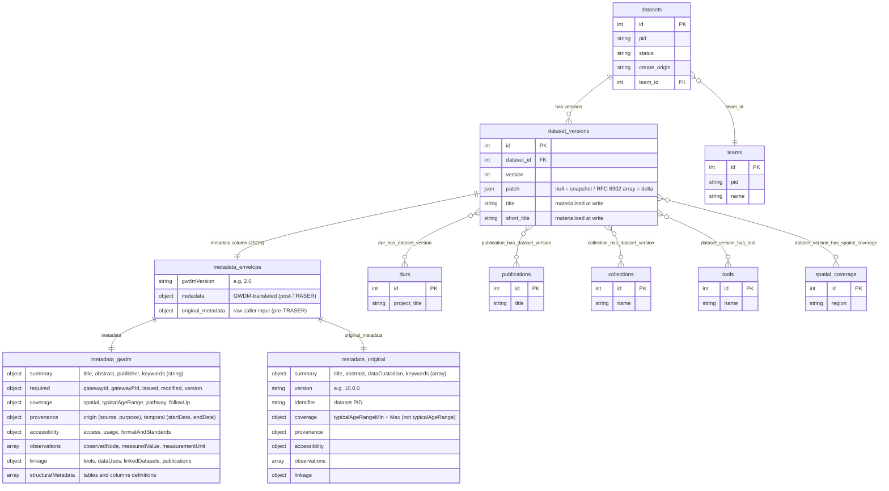
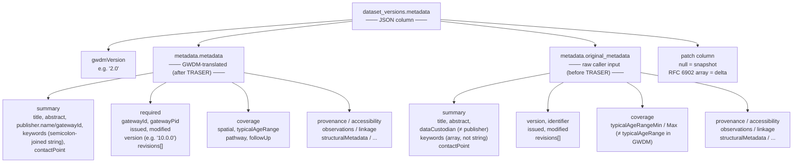

# Dataset Model Relationships & Metadata Structure

## Model relationships



## `dataset_versions.metadata` field structure

The `metadata` column is a single JSON blob with three top-level keys. `metadata.metadata` is the GWDM-normalised form produced by TRASER. `metadata.original_metadata` is the raw payload submitted by the caller, preserved exactly as received.



**Key differences between the two sub-objects** (real example, dataset 619):

| Field | `metadata.metadata` (GWDM) | `metadata.original_metadata` (raw) |
|---|---|---|
| Publisher | `summary.publisher.name` + `gatewayId` | `summary.dataCustodian.name` + `identifier` |
| Keywords | semicolon-joined string | array of strings |
| Age range | `coverage.typicalAgeRange` = `"0-1"` | `coverage.typicalAgeRangeMin` = `0`, `typicalAgeRangeMax` = `1` |
| Spatial | string, semicolon-delimited | — |

## How versions surface in the API response

`GET /v1/datasets/{id}` (via `DatasetService::prepareForShow`) returns `data.versions[]` — one element per call (always the latest, or the requested version). The raw `dataset_versions` row is returned directly; the `metadata` JSON column is decoded in-place, so `versions[0].metadata` in the response **is** the three-key envelope above:

```
data
 ├── id, pid, status, create_origin          ← datasets row
 ├── team { … }                              ← teams join
 ├── durs_count / publications_count / …     ← aggregated from pivot tables
 ├── spatialCoverage [ … ]                   ← dataset_version_has_spatial_coverage
 ├── durs / publications / collections       ← via pivot → version_ids filter
 └── versions [
       {
         id, dataset_id, version             ← dataset_versions columns
         patch                               ← null (snapshot) or RFC 6902 array (delta)
         title, short_title                  ← materialized at write time
         metadata: {
           gwdmVersion                       ─┐
           metadata:          { … }           ├─ decoded from metadata JSON column
           original_metadata: { … }          ─┘
         }
         linked_dataset_versions [ … ]       ← self-referential pivot
       }
     ]
```

For delta versions (`patch != null`), `prepareForShow` calls `getReconstructedMetadataEnvelope()` to apply the RFC 6902 patches back to the nearest snapshot before returning — so the caller always receives a complete `metadata.metadata` object regardless of how it was stored.
