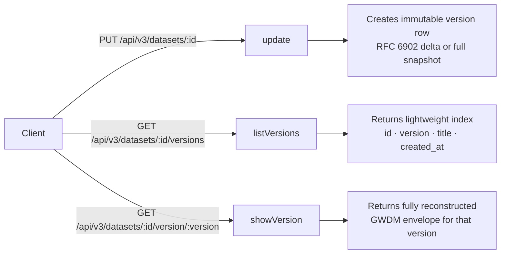
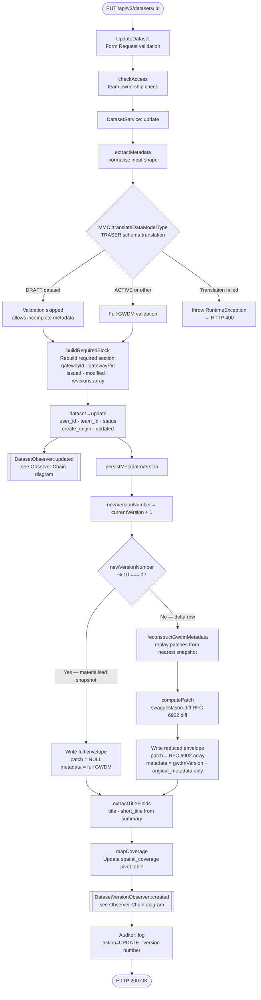
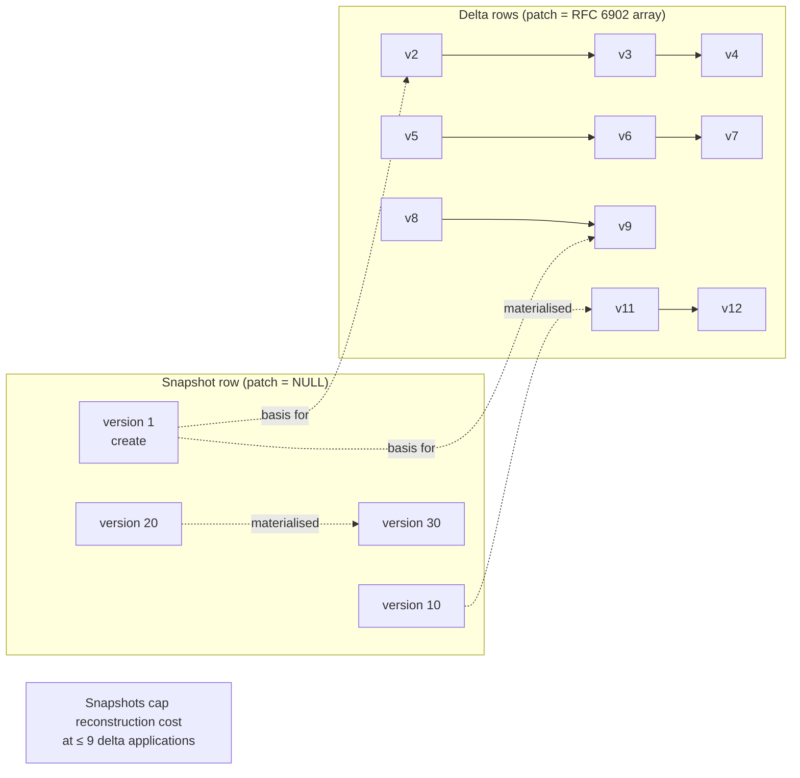
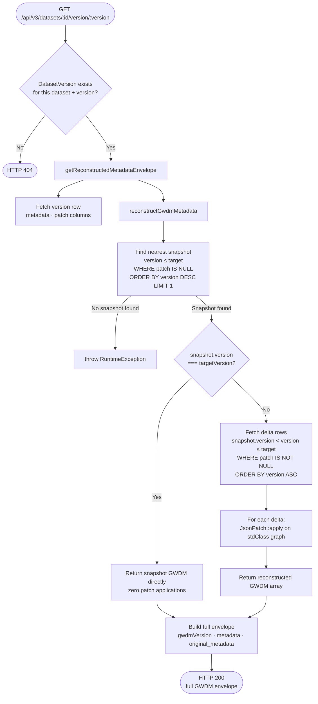
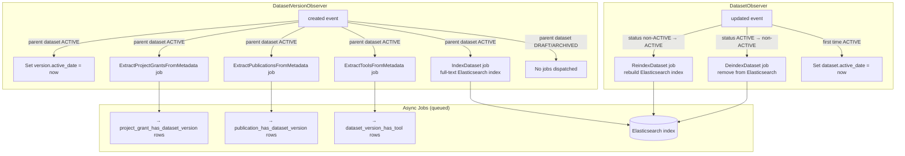
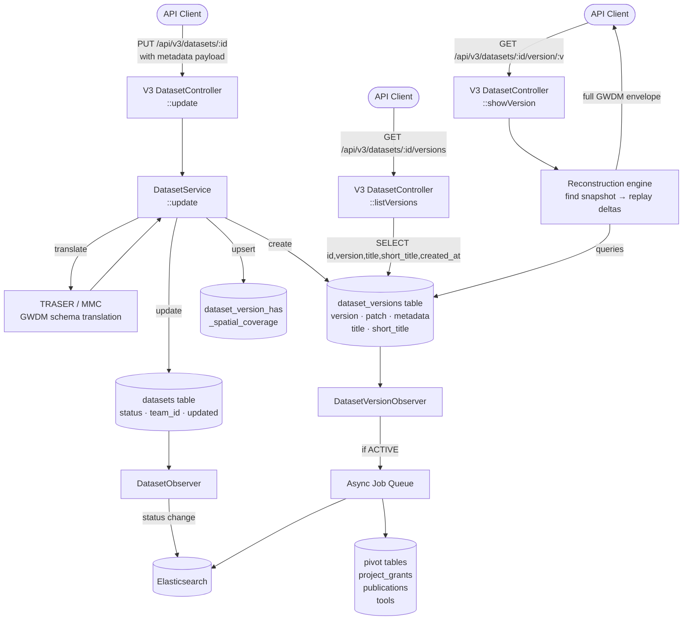
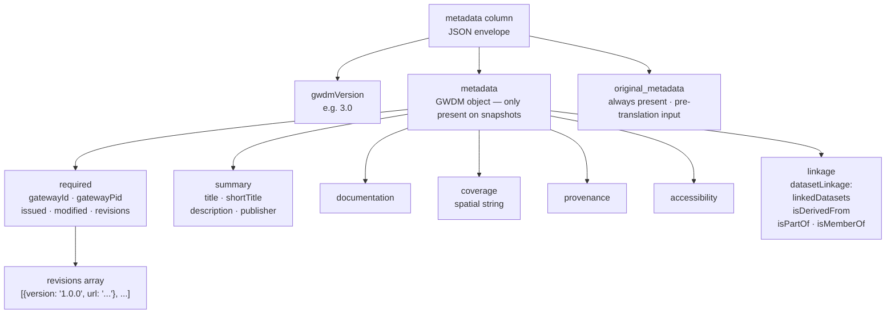

# V3 Dataset Management — System Diagrams

## 1. API Surface

Three endpoints make up the V3 dataset surface. `PUT` is the only mutating one; the two `GET` endpoints are read-only history accessors.

---

## 2. PUT /api/v3/datasets/:id — Full Update Flow

---

## 3. Snapshot vs Delta Decision

### What each row stores

| Field | Snapshot row | Delta row |
|---|---|---|
| `patch` | `NULL` | RFC 6902 array e.g. `[{op,path,value}]` |
| `metadata` | Full envelope: `{gwdmVersion, metadata:{...GWDM...}, original_metadata}` | Reduced: `{gwdmVersion, original_metadata}` — **no GWDM** |
| `title` | Extracted from `summary.title` | Extracted from `summary.title` |
| `short_title` | Extracted from `summary.shortTitle` | Extracted from `summary.shortTitle` |

---

## 4. GET /api/v3/datasets/:id/version/:version — Reconstruction Flow

---

## 5. Observer Chain — Side Effects After Every Write

---

## 6. Full Data Flow — End to End

---

## 7. GWDM Envelope Structure

---

## Key Invariants

| Rule | Detail |
|---|---|
| `patch = NULL` identifies a snapshot | Do not infer from any other column |
| `metadata` is nullable on delta rows | Queries selecting `metadata` must handle `null` |
| `title` / `short_title` are regular columns | Service must populate them on every version write (not DB-generated) |
| `required` block is always rebuilt | Never trust user-supplied `required`; service overwrites it |
| `pid` (UUID) is the stable public ID | `id` (int) is internal only — external systems must use `pid` |
| Raw DB mutations bypass observers | All indexing/extraction will be silently skipped |
| Spatial coverage accumulates | Old pivot rows are not removed when a new version supersedes them |
